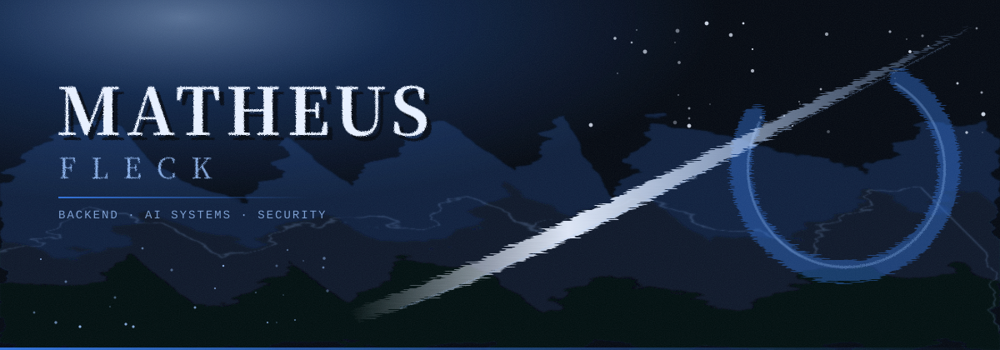

  Santa Maria, Brazil · Internet Systems student at UFSM 
  
  

I'm a backend developer building AI-powered systems, with one rule I don't bend: **every input is hostile until proven otherwise.** An LLM feature that trusts its prompts, leaks its context or can't be audited isn't finished — it's an attack surface.

Today I lead technical decisions for an internal agricultural operations platform, where Java, Spring Boot and PostgreSQL carry the core and Python drives the AI side: RAG pipelines, agentic workflows and LLM integrations. I'm studying Internet Systems at UFSM in Santa Maria, and on my own time I go deeper into cloud deployment and cybersecurity fundamentals.

**Current focus**

- Leading technical decisions for an internal agricultural operations platform
- Exploring AI agents, RAG architectures, and LLM integration patterns
- Strengthening secure software design, cloud deployment, and cybersecurity practices

*Generated daily from my GitHub contribution calendar.*

| | Project | What it does | Stack |
|:-:|---|---|---|
| ◆ | **Agricultural operations platform** | Internal platform for agricultural operations (code is not public) | Java · Spring Boot · PostgreSQL |
<!-- TODO: add public projects here: | ○ | [**Name**](repo-url) | one-line description | stack | -->

*◆ employer/private · ○ public*

            

**AI:** RAG · AI Agents · LangChain · LlamaIndex · Harness  
**Infra:** MinIO · Kubernetes · AWS · GCP
